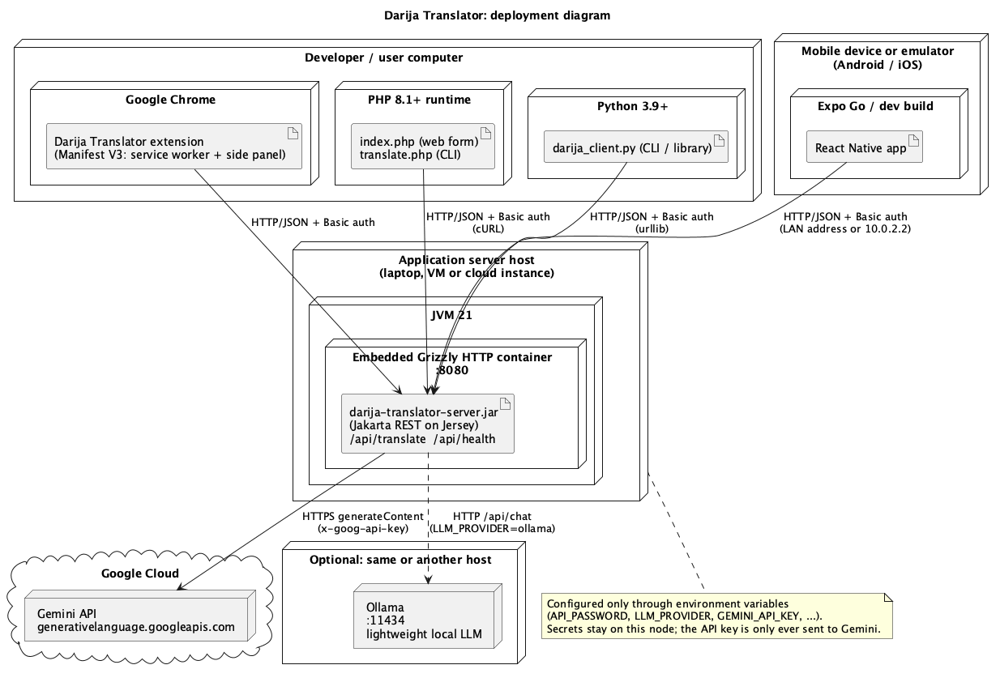

# Darija Translator: an LLM-powered RESTful web service

Translate text from any language into **Moroccan Arabic (Darija)** using a Large Language Model, and use it from a
Chrome extension, a PHP app, a Python app and a React Native mobile app.

Mini Project 2 (LLM-powered RESTful Web Service): a Jakarta REST service backed by Google Gemini (free tier) or a local
Ollama model, secured with HTTP Basic authentication, plus the clients listed below.

| Part | Folder | What it is |
|------|--------|------------|
| REST service | [`server/`](server) | Maven project. Jakarta REST (Jersey) on an embedded Grizzly container, one runnable jar |
| Chrome extension | [`chrome-extension/`](chrome-extension) | Manifest V3, `chrome.sidePanel`, context menu, read aloud, voice-to-voice |
| PHP client | [`clients/php/`](clients/php) | cURL library, CLI script and a small web form |
| Python client | [`clients/python/`](clients/python) | Library, CLI and interactive mode (standard library only) |
| Mobile app | [`clients/react-native/`](clients/react-native) | React Native (Expo) for Android and iOS |
| UML | [`docs/uml/`](docs/uml) → [`docs/img/`](docs/img) | Class, deployment, sequence and use-case diagrams |

## Architecture



All clients talk to one REST endpoint. The service authenticates the caller, validates the text, asks the LLM for a
translation and returns clean JSON. More diagrams: [class diagram](docs/img/class-diagram.png),
[sequence diagram](docs/img/sequence-translate.png), [use cases](docs/img/use-case-diagram.png). The editable
PlantUML sources are in [`docs/uml/`](docs/uml).

## 1. Run the REST service

**Requirements:** JDK 21+ and Maven 3.9+. The project path must **not contain a `:`** (Java uses it to separate
classpath entries and the build breaks).

### Quick try, no API key (mock translator)

```bash
cd server
mvn package
LLM_PROVIDER=mock API_PASSWORD=demo-password java -jar target/darija-translator-server.jar
```

The mock only knows a few phrases ("Hello", "How are you?", "Thank you", …) and marks everything else with `[MOCK]`.
It exists for offline demos and tests.

### With Google Gemini (free tier)

1. Create an API key at <https://aistudio.google.com/apikey>.
2. Copy `server/.env.example` to `server/.env` and fill in `GEMINI_API_KEY` and `API_PASSWORD`.
3. Start it:

```bash
./scripts/run-server.sh
```

> **Model name:** Google renames and retires free-tier models regularly. The default is `gemini-2.5-flash`, set in
> `GEMINI_MODEL`. If the service answers `502 llm_model_not_found`, choose a current Flash model from
> <https://ai.google.dev/gemini-api/docs/models>. The `/api/health` endpoint shows which model is configured.

### With a local lightweight LLM (Ollama, offline and free)

```bash
ollama pull llama3.2
LLM_PROVIDER=ollama API_PASSWORD=demo-password ./scripts/run-server.sh
```

### Configuration (environment variables)

| Variable | Default | Meaning |
|----------|---------|---------|
| `API_USERNAME` | `student` | Basic-auth user name |
| `API_PASSWORD` | random, printed once at start-up | Basic-auth password |
| `LLM_PROVIDER` | `gemini` | `gemini`, `ollama` or `mock` |
| `GEMINI_API_KEY` | none (required for `gemini`) | Google AI Studio key |
| `GEMINI_MODEL` | `gemini-2.5-flash` | Gemini model id |
| `OLLAMA_URL` / `OLLAMA_MODEL` | `http://localhost:11434` / `llama3.2` | Local model server |
| `HOST` / `PORT` | `0.0.0.0` / `8080` | Listen address (`0.0.0.0` lets a phone on your Wi-Fi connect) |
| `MAX_TEXT_LENGTH` | `5000` | Longest accepted text (characters) |
| `LLM_TIMEOUT_SECONDS` | `45` | How long to wait for the LLM |
| `CORS_ALLOWED_ORIGIN` | `*` | Browser origin allowed to call the API |

## 2. The REST API

Base path `/api`. `TranslatorResource.translate()` is the business method.

| Method and path | Auth | Purpose |
|-----------------|------|---------|
| `POST /api/translate` | Basic | Translate the JSON `text` (preferred) |
| `GET /api/translate?text=…&source=…&script=…` | Basic | Same, for quick tests |
| `GET /api/health` | none | Liveness plus the active provider and model |

Request body:

```json
{ "text": "How are you?", "sourceLanguage": "English", "script": "arabic" }
```

`sourceLanguage` is optional (omit or `"auto"` to detect). `script` is `"arabic"` (default) or `"latin"` (Arabizi: `kif dayr?`).

Response:

```json
{
  "translation": "كيف داير؟",
  "sourceLanguage": "English",
  "targetLanguage": "Moroccan Arabic (Darija)",
  "script": "arabic",
  "provider": "gemini",
  "model": "gemini-2.5-flash"
}
```

Every error is JSON `{"error": "<code>", "message": "<text>"}`:

| Status | `error` | When |
|--------|---------|------|
| 400 | `invalid_request` / `invalid_json` | Blank text, bad script or language, malformed JSON |
| 401 | `unauthorized` | Missing or wrong credentials (`WWW-Authenticate: Basic`) |
| 413 | `text_too_long` | Longer than `MAX_TEXT_LENGTH` |
| 415 | `unsupported_media_type` | Body is not `application/json` |
| 422 | `llm_blocked` | The LLM's safety filter refused the text |
| 429 | `llm_rate_limited` | Free-tier quota reached; wait and retry |
| 502 | `llm_unreachable`, `llm_rejected_request`, `llm_model_not_found`, `llm_unavailable`, `llm_empty_answer` | Problem at the LLM provider (details in `message`) |
| 504 | `llm_timeout` | The LLM did not answer in time |

### Test it with cURL or Postman

```bash
curl http://localhost:8080/api/health

curl -u student:demo-password -H 'Content-Type: application/json' \
     -d '{"text":"Good morning","script":"latin"}' \
     http://localhost:8080/api/translate

curl -i http://localhost:8080/api/translate        # 401 without credentials
```

Postman: import [`docs/postman_collection.json`](docs/postman_collection.json) and set the `baseUrl`, `username`
and `password` collection variables.

## 3. Chrome extension (Manifest V3)

1. Start the service.
2. Open `chrome://extensions`, switch on **Developer mode**, press **Load unpacked** and choose the `chrome-extension` folder.
3. Click the extension's toolbar icon: the **side panel** opens. In ⚙ Settings enter the server URL, user name and
   password, then **Save & test**.

How to use it:

- **Right-click selected text → "Translate “…” to Darija".** The side panel opens, the selection is pasted into the
  box and translated immediately.
- **Toolbar icon with text selected:** the selection is grabbed and translated when the panel opens.
- **Keyboard shortcut** `Ctrl+Shift+Y` (`Command+Shift+Y` on Mac), changeable at `chrome://extensions/shortcuts`.
- **🔊 Read aloud** reads the Darija with a Moroccan Arabic voice if the system has one, otherwise any Arabic voice.
  Latin-script output is read with a French voice.
- **🎤 Speak (voice to voice):** say a sentence in English, French, Spanish, German or Arabic. It is transcribed, translated
  to Darija and read back. The first time, Chrome cannot ask for microphone permission inside a side panel, so the
  panel offers an **Allow microphone** button that opens a one-time permission tab.
- 📋 **Copy**, plus optional "copy every translation" and "read every translation aloud" settings.

Permissions, and why: `sidePanel` (the UI), `contextMenus` (right-click entry), `storage` (settings; hand-over of the
selected text), `activeTab` and `scripting` (read the current selection), `clipboardWrite` (copy button), and host access
to `localhost`. For a server on another machine the panel asks for access to that one host when you press Save.

## 4. Clients

### Python

```bash
cd clients/python
export DARIJA_PASSWORD=demo-password          # DARIJA_URL and DARIJA_USER are optional
python3 darija_client.py "How are you?"
python3 darija_client.py --script latin "Good morning"
echo "See you tomorrow" | python3 darija_client.py
python3 darija_client.py --interactive
```

### PHP (8.1+ with the cURL extension)

```bash
cd clients/php
export DARIJA_PASSWORD=demo-password
php translate.php "How are you?"                       # command line
php translate.php --script=latin --source=English "Good morning"
php -S localhost:8000                                  # web form at http://localhost:8000
```

### React Native (Expo)

```bash
cd clients/react-native
npm install
npx expo start            # then press i (iOS simulator), a (Android emulator) or scan the QR code with Expo Go
```

In the app's ⚙ settings enter the server address:

| Where the app runs | Server URL |
|--------------------|------------|
| iOS simulator | `http://localhost:8080` |
| Android emulator | `http://10.0.2.2:8080` |
| Real phone (same Wi-Fi) | `http://<your-computer-LAN-IP>:8080` |

The password is stored in the device's secure storage (Keychain / Keystore). Plain `http://` is allowed for local
development through `app.json`; use HTTPS when the service is not on your own network.

## 5. Tests

| Component | Command | Covers |
|-----------|---------|--------|
| Server | `cd server && mvn test` | Config, prompts, validation, Gemini/Ollama clients against a fake HTTP server, and the full HTTP stack (auth, CORS, JSON errors, status mapping) |
| Extension | `cd chrome-extension && npm test` | URL handling, Basic auth header, error mapping, voice selection |
| Python | `cd clients/python && python3 -m unittest` | Client and CLI against a fake server |
| React Native | `cd clients/react-native && npm test` | Same client logic as the extension (Node 22.7+) |

## 6. Design notes and limits

- **Authentication.** Endpoints under `TranslatorResource` require HTTP Basic credentials. The check is a Jakarta REST
  `ContainerRequestFilter` that installs a `SecurityContext`, and `@RolesAllowed` enforces the role (Jersey's
  `RolesAllowedDynamicFeature`). It does **not** use the servlet-container SPI of the Jakarta Authentication specification
  (`ServerAuthModule` / JASPIC), because the service runs on an embedded Grizzly container, which has no servlet layer.
  Moving to Jetty or Tomcat with a `ServerAuthModule` would be a drop-in replacement for `BasicAuthFilter`.
- **Credentials.** Basic auth sends the password with every request, so use HTTPS (a reverse proxy such as Caddy or nginx
  in front of the jar) for anything beyond your own machine. Passwords are compared in constant time, and a random
  password is generated if you do not set one. The extension stores its password unencrypted in the Chrome profile.
- **Prompt injection.** The user's text is wrapped in `<text>` tags and the prompt tells the model to translate it, not
  obey it; any `<text>` tag inside the input is neutralised. This reduces, but cannot eliminate, the risk.
- **Privacy.** Server logs record the length and duration of each translation, never the text. On Gemini's free tier,
  Google may use submitted content to improve its models; do not send confidential text.
- **Rate limits.** The free tier is limited per minute and per day. Quota errors surface as `429 llm_rate_limited`.
- **Translation quality.** Darija has no standard spelling, and LLM output varies. Latin-script output uses common
  chat conventions (3, 7, 9). Check important translations with a native speaker.
- **HTTP/2.** Grizzly's HTTP/2 add-on is enabled because clients that attempt the cleartext HTTP/2 upgrade (the JDK
  `HttpClient`, `curl --http2`) otherwise hang on POST bodies. HTTP/1.1 clients are unaffected.

## 7. Submission checklist

- [ ] Source code: `./scripts/package.sh <StudentName>` creates `<StudentName>_project2.zip` (no `node_modules` or build output)
- [ ] GitHub repository link with commit history and this README
- [ ] 5-minute demo video: [`docs/DEMO_SCRIPT.md`](docs/DEMO_SCRIPT.md) has a minute-by-minute outline
- [ ] UML diagrams: [`docs/img/`](docs/img) (class, deployment, sequence, use case)
- [ ] Optional: blog post about the development process
